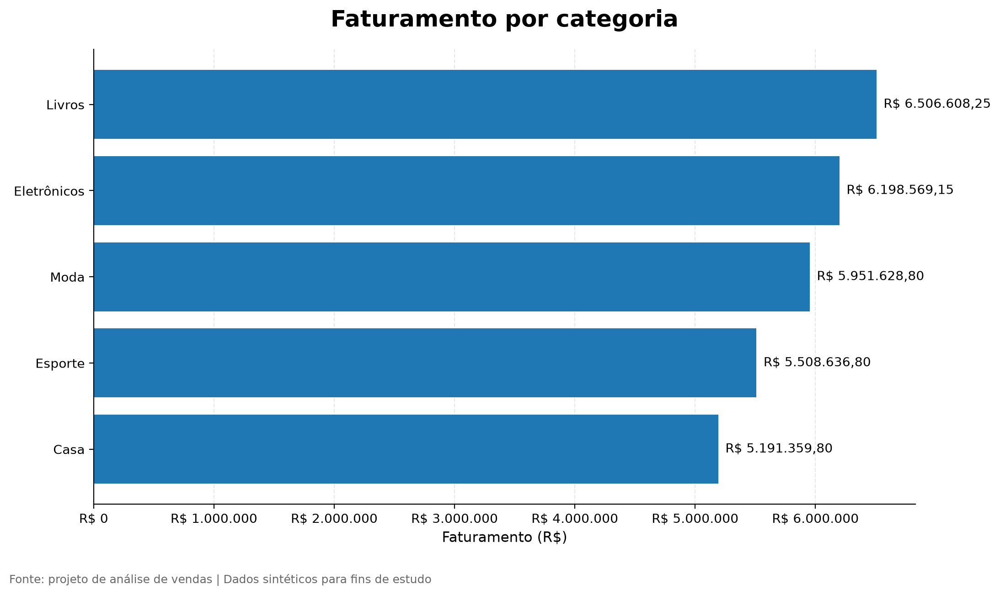

# Análise de Vendas de E-commerce com SQL e PostgreSQL

## Sobre o projeto

Este projeto tem como objetivo aplicar conceitos de análise de dados para investigar o desempenho de vendas de um e-commerce, transformando dados estruturados em indicadores que apoiam a tomada de decisão.

O projeto contempla a modelagem de um banco de dados relacional, a geração de dados sintéticos e a elaboração de consultas SQL para analisar pedidos, faturamento, ticket médio e desempenho por categoria de produto.

**Nota:** todos os dados são fictícios e foram gerados para fins educacionais. Os resultados não representam uma empresa real.

## Objetivos

- Modelar um banco de dados relacional.
- Praticar consultas SQL e agregações no PostgreSQL.
- Analisar o comportamento mensal e anual das vendas.
- Comparar categorias de produtos.
- Calcular indicadores para apoiar decisões de negócio.
- Documentar o processo analítico de forma reproduzível.

## Tecnologias utilizadas

- PostgreSQL 17
- SQL
- Git e GitHub

**Próximas etapas planejadas:** Python, Pandas e visualização de dados.

## Estrutura do banco de dados

O banco `analise_vendas` possui quatro tabelas:

| Tabela | Descrição |
|---|---|
| `clientes` | Cadastro de clientes fictícios |
| `produtos` | Catálogo de produtos, categorias e preços |
| `pedidos` | Data, cliente e status dos pedidos |
| `itens_pedido` | Produtos, quantidades, preços e descontos de cada pedido |

As tabelas utilizam chaves primárias, chaves estrangeiras, restrições de integridade e índices.

## Volume de dados

| Entidade | Registros |
|---|---:|
| Clientes | 1.000 |
| Produtos | 50 |
| Pedidos | 10.000 |
| Itens de pedidos | 25.000 |
| **Total** | **36.050** |

Os pedidos abrangem janeiro de 2025 a dezembro de 2026.

## Análises SQL desenvolvidas

1. **Pedidos por mês:** distribuição dos pedidos por status.
2. **Faturamento e ticket médio:** indicadores mensais dos pedidos concluídos.
3. **Faturamento por categoria:** comparação do faturamento, das unidades vendidas e dos pedidos com itens de cada categoria.
4. **Comparação anual:** análise do número de pedidos concluídos, faturamento e ticket médio.
5. **Variação mensal entre anos:** comparação do faturamento de cada mês de 2026 com o mesmo mês de 2025.

## Resultados iniciais

- Foram gerados 10.000 pedidos e 25.000 itens.
- A base possui 9.100 pedidos concluídos.
- A categoria Livros apresentou o maior faturamento na análise inicial.
- Os indicadores anuais apresentaram pequenas variações entre 2025 e 2026.
- As comparações mensais permitiram identificar oscilações positivas e negativas.

Os resultados são descritivos e refletem as regras utilizadas na geração dos dados. Não permitem atribuir causas às variações nem generalizar conclusões para empresas reais.

## Limitações

- Os dados são sintéticos, não transações reais.
- A geração matemática pode criar padrões artificiais.
- Os indicadores dependem dos preços, quantidades, descontos e status definidos nos scripts.
- O faturamento calculado considera os itens dos pedidos concluídos após os descontos cadastrados. Não equivale necessariamente à receita contábil líquida de uma empresa.

## Como executar

### Pré-requisitos

- PostgreSQL instalado e em execução.
- Cliente `psql` disponível no terminal.

### 1. Criar o banco

Conecte-se ao PostgreSQL e execute:

```sql
CREATE DATABASE analise_vendas;
```

### 2. Criar as tabelas

Na pasta do projeto, execute no PowerShell:

```powershell
psql -U postgres -h localhost -p 5432 -d analise_vendas -f sql\01_create_tables.sql
```

### 3. Gerar os dados

```powershell
psql -U postgres -h localhost -p 5432 -d analise_vendas -f sql\02_generate_data.sql
```

### 4. Executar as análises

```powershell
psql -U postgres -h localhost -p 5432 -d analise_vendas -f sql\03_analysis_queries.sql
```

**Atenção:** o script de geração foi desenvolvido para uma base vazia. Execute-o apenas uma vez por carga, para evitar duplicações e conflitos.

## Próximas melhorias

- Explorar os dados com Python e Pandas.
- Criar gráficos para os indicadores.
- Investigar a qualidade e os padrões dos dados.
- Desenvolver um dashboard.
- Ampliar as análises de clientes e produtos.


## Visualização dos dados

Para complementar as consultas SQL, foi desenvolvido um gráfico de barras horizontais utilizando Python e Matplotlib, permitindo comparar o faturamento das categorias de produtos.

### Faturamento por categoria



A análise considera apenas pedidos concluídos e calcula o faturamento com base na quantidade vendida, no preço unitário e nos descontos aplicados.

Principais resultados:
- **Livros:** R$ 6.506.608,25
- **Eletrônicos:** R$ 6.198.569,15
- **Moda:** R$ 5.951.628,80
- **Esporte:** R$ 5.508.636,80
- **Casa:** R$ 5.191.359,80

Nesse conjunto de dados, Livros apresenta o maior faturamento entre as categorias analisadas.

**Observação:** os dados utilizados neste projeto são sintéticos, gerados para fins de estudo e demonstração técnica. Os resultados não representam vendas reais.


## Machine Learning: previsão de faturamento

Nesta etapa, o projeto foi ampliado com um experimento de Machine Learning utilizando Python e scikit-learn.

O objetivo foi utilizar o histórico mensal de faturamento extraído do PostgreSQL para treinar um modelo de regressão linear e avaliar sua capacidade de estimar valores futuros.

### Metodologia

1. Extração do faturamento mensal por meio de uma consulta SQL.
2. Preparação dos dados em ordem cronológica.
3. Separação dos últimos seis meses para teste, utilizando os meses anteriores para treinamento.
4. Treinamento de um modelo de regressão linear.
5. Comparação com um modelo de referência que repete o último faturamento observado no período de treinamento.
6. Avaliação com MAE, RMSE e erro percentual absoluto médio.
7. Geração de previsões exploratórias para os três meses seguintes ao histórico disponível.

### Resultados da avaliação

A avaliação foi realizada nos seis meses reservados para teste.

| Métrica | Regressão linear | Modelo de referência |
|---|---:|---:|
| MAE | R$ 26.926,60 | R$ 51.038,20 |
| RMSE | R$ 35.363,56 | R$ 58.142,91 |

O erro percentual absoluto médio da regressão linear foi de 2,14%. O MAE foi aproximadamente 47,24% menor que o da referência nesse período de teste.

Esses resultados indicam que a regressão linear superou a referência na avaliação realizada. Entretanto, não garantem o mesmo desempenho em outros períodos ou em dados reais.

### Previsões exploratórias

| Mês | Faturamento previsto |
|---|---:|
| Janeiro de 2027 | R$ 1.234.894,47 |
| Fevereiro de 2027 | R$ 1.235.830,02 |
| Março de 2027 | R$ 1.236.765,57 |

As estimativas foram geradas a partir de uma regressão linear baseada no índice temporal. Elas são experimentais e não consideram explicitamente sazonalidade, campanhas comerciais ou outras variáveis que possam influenciar as vendas.

### Arquivos gerados

- `machine_learning/previsao_faturamento.py`: script de extração, treinamento, avaliação e previsão.
- `machine_learning/resultados_avaliacao.csv`: resultados do teste, incluindo valores reais, previsões e erros.
- `machine_learning/previsao_faturamento.png`: gráfico do histórico, das previsões de teste e das estimativas futuras.

### Limitações

Os dados são sintéticos e abrangem 24 meses. Por isso, o experimento tem finalidade educacional e não representa uma solução de previsão validada para operações comerciais reais.

Como evolução futura, podem ser avaliados modelos adicionais, validação temporal com múltiplas janelas e variáveis explicativas, sempre comparando os resultados com referências simples.

**Tecnologias:** PostgreSQL, SQL, Python, pandas, scikit-learn, Matplotlib e Git.


## Autor

**Vitor Morais**

Estudante de Engenharia de Computação no IFMG — Campus Bambuí, com interesse em Análise de Dados, desenvolvimento de software e uso de tecnologia para apoiar decisões.